# Tim's Kyria (QMK userspace)

Firmware for my splitKB Kyria. This is a [QMK External Userspace](https://docs.qmk.fm/newbs_external_userspace):
only my keymap lives here, `qmk_firmware` is pinned as a submodule, and GitHub Actions builds the `.hex`.



| Path | What |
|---|---|
| `keyboards/splitkb/kyria/keymaps/timothykrell/` | The keymap (`keymap.c`, `config.h`, `rules.mk`) |
| `reference/original-2021/` | The original 2021 keymap source, kept for history |
| `reference/github-2021-keymap.json` | Decoded keymap table from a build of the original 2021 keymap |
| `tools/` | Build / flash / verify / flash-dump / diagram scripts |
| `qmk_firmware/` | Pinned upstream QMK (submodule) |

## Hardware

* **Kyria rev1** (`splitkb/kyria/rev1`). The firmware that shipped on the board reports USB device version
  `0.0.1` and uses the rev1 pinout. Rev2 firmware uses different pins and will **not** work on this PCB.
* ATmega32u4 with the Atmel DFU bootloader (Elite-C style), 28,672 bytes available for firmware.
* Handedness is stored in each half's EEPROM (`EE_HANDS`). It survives reflashing.

## Day-to-day

The scripts only need `docker` and `lsusb`. Everything else runs in the official `ghcr.io/qmk/qmk_cli` image.

```sh
tools/build.sh        # compile -> splitkb_kyria_rev1_base_timothykrell.hex
tools/verify.sh       # prove the compiled keymap still matches the reference, key by key
tools/flash.sh        # build, wait for RESET, flash. Run once per half.
tools/draw.sh         # regenerate keymap.svg (keymap-drawer, via uvx)
```

To flash: plug in the left half alone, run `tools/flash.sh`, then tap the reset button on its controller.
Repeat for the right half. Both halves must run the same build.

If you'd rather use a local QMK CLI: `qmk config user.overlay_dir="$(pwd)"`, then
`qmk compile -kb splitkb/kyria/rev1 -km timothykrell` or `qmk flash ...` as usual.

To update QMK: `git -C qmk_firmware pull origin master`, rebuild, run `tools/verify.sh`, then commit the
submodule bump.

## How this was reconstructed

The original keymap was in `TimothyKrell/qmk_firmware` (`keyboards/kyria/keymaps/timothykrell`, last
commit Jan 2021). The firmware actually on the board reports itself as `8D1D:9D9D "splitKB Kyria"`.
Those USB strings only existed in upstream QMK between 2021-07-26 and 2022-02-21, so the board was
flashed from a later local checkout than what's on GitHub.

The port was checked as follows:

1. Built the 2021 GitHub keymap against QMK from that era (`9bf25d1cd5`, 2022-02-20).
2. `tools/kmtool.py` locates the 9×8×8 `keymaps` table inside a firmware image and decodes every
   keycode by meaning. QMK renumbered most keycodes in late 2022, so raw bytes can't be compared.
3. Compared that decode with the current build: **all 450 key positions are identical**.

### Checking the firmware that is on the board right now

`tools/dump-flash.sh` is **read-only**. It waits for the bootloader and copies the flash and EEPROM to
`dumps/`. It then restarts the existing firmware, decodes the dumped keymap into
`reference/on-board-keymap.json`, and diffs it against the GitHub version. If there are differences,
port them into `keymap.c`. `tools/verify.sh` then compares against the on-board dump instead.

### Old → new QMK equivalents used

| 2021 keymap | Now |
|---|---|
| `IGNORE_MOD_TAP_INTERRUPT_PER_KEY` (true for everything except the two shift thumbs) | `HOLD_ON_OTHER_KEY_PRESS_PER_KEY` (true only for the two shift thumbs) |
| `TAPPING_FORCE_HOLD_PER_KEY` for Lower/Space | `QUICK_TAP_TERM_PER_KEY` returning `0` for Lower/Space |
| `encoder_update_user()` | `ENCODER_MAP_ENABLE` + `encoder_map[]` |
| `OLED_DRIVER_ENABLE`, `void oled_task_user`, `USB_LED_*` | `OLED_ENABLE`, `bool oled_task_user`, `led_t` |
| `RGBLIGHT_ANIMATIONS` | individual `RGBLIGHT_EFFECT_*` defines |
| `RGB_TOG`, `RGB_MOD`, `KC_MS_L`, ... | `UG_TOGG`, `UG_NEXT`, `MS_LEFT`, ... |
| `LAYOUT_base` / `LAYOUT_base2` wrapper macros | Home-row mods written out per layer (same resulting keycodes) |

### Quirks preserved on purpose (they're in the original)

* The gaming layers' `LM(_GRAISE, KC_LSFT)` key is really **G-Raise + Left Ctrl**. `LM()` takes a `MOD_*`
  mask, and `KC_LSFT` masks down to `MOD_LCTL`. It's now written as `LM(_GRAISE, MOD_LCTL)`.
* Because the home-row-mod wrapper also applied to Raise and G-Raise, a few keys there are mods wrapped
  around `KC_TRNS` (e.g. `RCTL_T(_______)`). Holding them gives the mod; tapping does nothing.
* Home-row mods are also active on the number row of Raise/G-Raise (e.g. hold `6` on Raise = Shift).

## Possible upgrades (not enabled, they would change behaviour)

* [Chordal Hold](https://docs.qmk.fm/tap_hold#chordal-hold) and [Flow Tap](https://docs.qmk.fm/tap_hold#flow-tap):
  modern home-row-mod helpers that cut down on accidental mods while typing fast.
* A `QK_BOOT` key somewhere (e.g. on Adjust), so flashing doesn't need the reset button.
* `get_highest_layer(layer_state | default_layer_state)` in the OLED code, so the screen shows
  "Gaming" when a gaming layer is the default layer.
